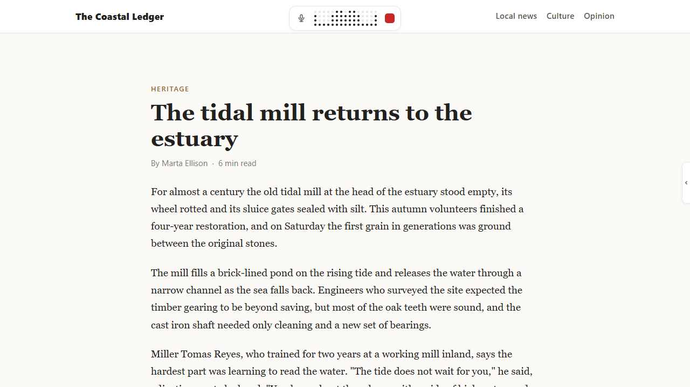
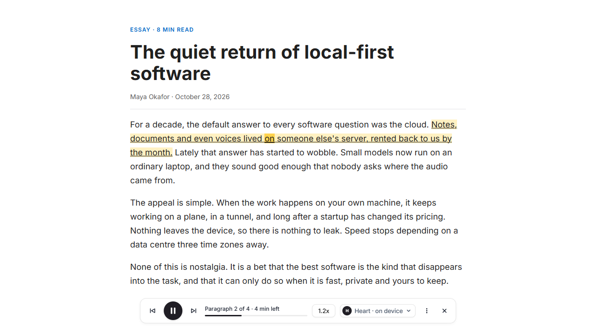
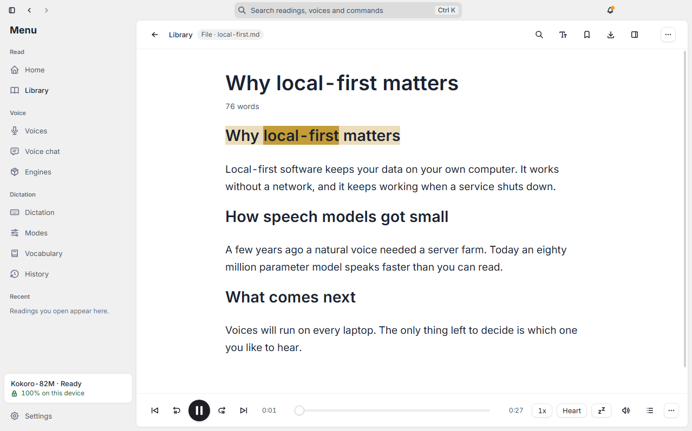
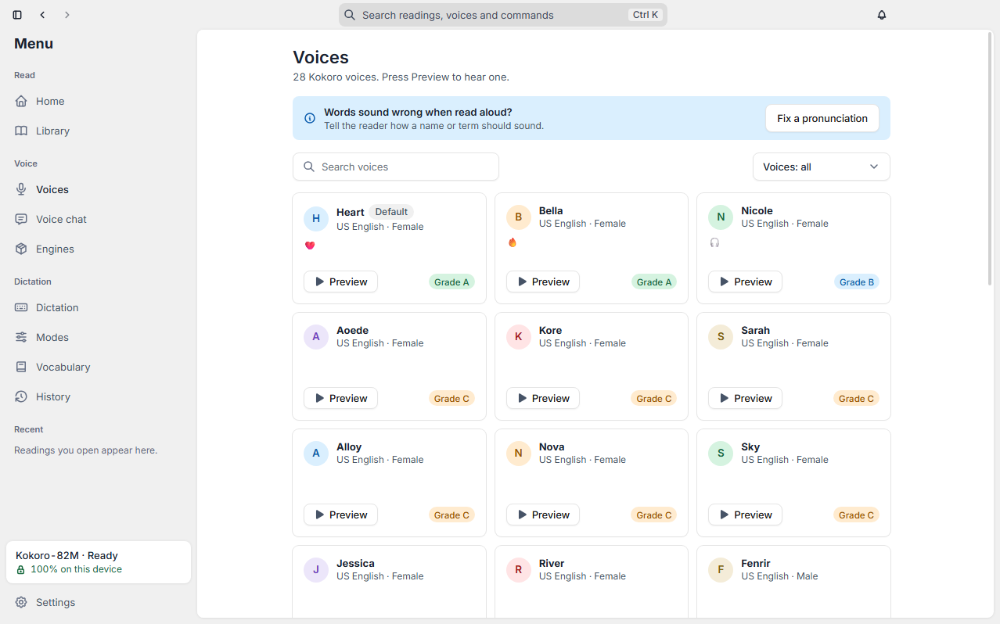
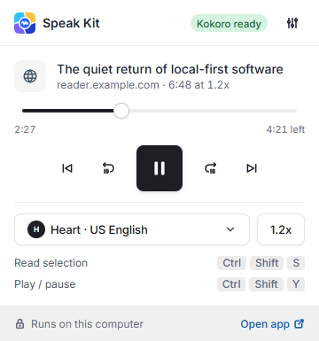
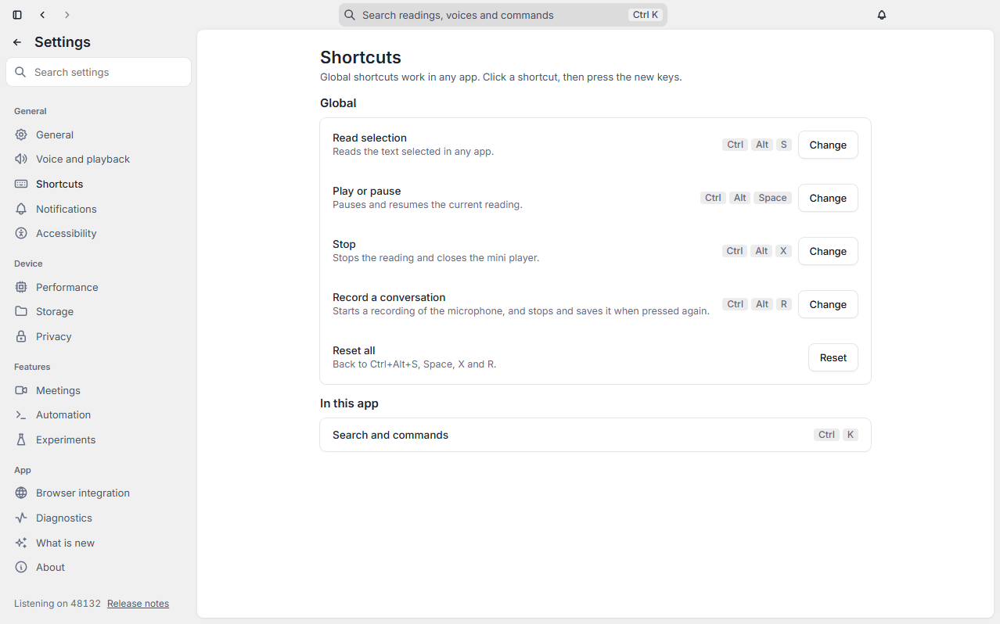
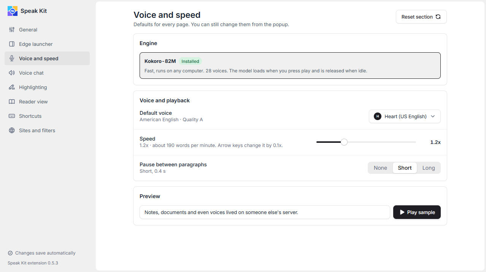

  

<h1 align="center">Speak Kit</h1>

Read pages aloud, dictate into any app, or talk to a page. For Chrome and desktop.

  

Speak Kit is a set of speaking tools for Chrome and your desktop: have pages read to you, dictate into any app, and talk to a page out loud.

  

## Features

**Voice chat.** Press the Talk button on a page, or Alt+Shift+V, and ask about it out loud. A small pill at the top of the page shows when it is listening, thinking or speaking. It uses OpenAI's Realtime API with your own key.

**Read aloud.** Select text in Chrome, press a key, and a natural voice reads it while the current sentence and word are highlighted. The Chrome extension reads selections and whole pages, with a floating player, a reader view and a side panel queue. 28 Kokoro voices run on the CPU of any computer.

**Dictation (Windows).** Hold Right Ctrl in any app, speak, release, and the text is pasted where your cursor is. English filler words are removed, your own words and the way they are misheard are swapped in, each app can have its own mode, past dictations are kept in a history, and a misheard word you fix once, in the history or with an optional shortcut, is added to your words and corrected from then on. Speech recognition runs on your computer with Whisper or Parakeet models.

**Library.** The desktop app opens PDF, EPUB, DOCX, Markdown and text files, reads them with word highlighting, and exports MP3 and WAV.

**Transcripts.** Turn audio files into text on your computer.

**Everywhere.** Global shortcuts, a mini player, a command palette, and an interface in English, Spanish, German, French and Arabic.

**Coming next.** More tools and a public beta are planned.

  

| | |
|---|---|
|  |  |
| Reader with word highlighting | 28 voices, each with a preview |
|  |  |
| Extension popup | Global shortcuts you can change |
|  | |
| Extension options | |

## Install

Download from the [latest release](https://github.com/NourEldinShobier/speak-kit/releases/latest):

- **Windows:** `Speak-Kit-Setup-<version>.exe` (installer, updates itself) or `Speak-Kit-<version>-portable.exe`. The builds are not code-signed, so SmartScreen shows "unknown publisher" the first time: choose **More info**, then **Run anyway**.
- **macOS:** the `.dmg` for your chip (Apple Silicon or Intel). The app is not signed: right-click it in Applications, choose **Open**, then **Open** again. It is built for macOS but tested on Windows only, and dictation is untested on a Mac.
- **Chrome extension:** unzip `speakkit-extension-<version>.zip`, open `chrome://extensions`, turn on **Developer mode**, choose **Load unpacked** and pick the folder.

On first start the app downloads the voice model (about 180 MB) and walks you through setup. To connect the extension, copy the token in the app (Browser) and paste it in the extension under Options, General, Pairing token.

Dictation downloads a speech model when you first turn it on (about 550 MB for the default, Whisper large-v3 turbo). It needs a graphics card; on a computer without one, choose the smaller Parakeet model, which handles English and German.

## Voice chat

Voice chat needs an OpenAI API key. Add it in the app under Voice chat. The key is stored encrypted by your operating system and is never given to the extension; the extension receives a short-lived session secret from the app for each conversation. Start a conversation from the Talk button on a page or with Alt+Shift+V.

## Privacy

Reading aloud, dictation and transcripts run on your computer. The local server listens on `127.0.0.1` only and needs a token. Network traffic is the model downloads and the update check against GitHub Releases, which you can turn off in Settings, About. No analytics, no accounts.

The optional Learn correction shortcut reads the text of the field you were typing in once, at the moment you press it; nothing leaves your computer.

Voice chat is the exception, and only while a conversation is open: your microphone audio, the text of the page and its address are sent to OpenAI and billed to your key.

## Contributing

Build instructions, tests and conventions are in [CONTRIBUTING.md](CONTRIBUTING.md).

## License

[Apache-2.0](LICENSE)
