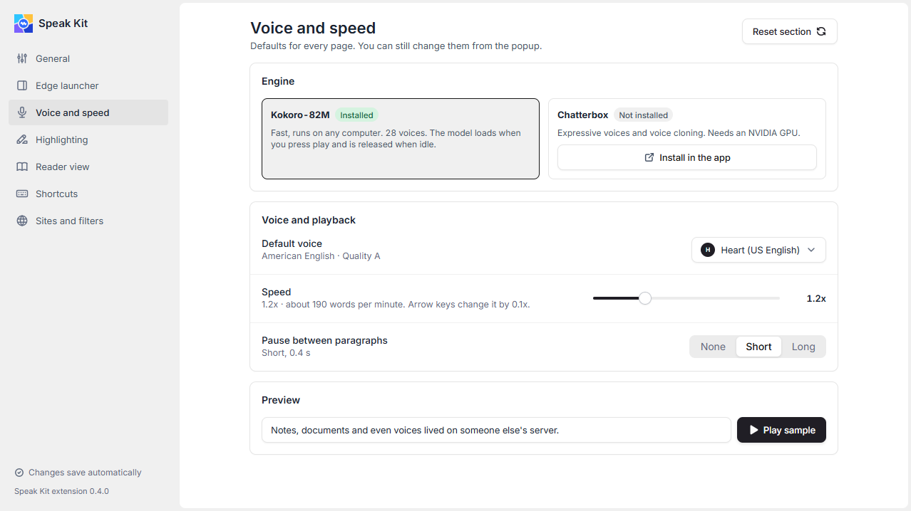

  

<h1 align="center">Speak Kit</h1>

A private, local text-to-speech reader for Chrome and desktop.

  

Select text in Chrome, press a key, and a natural voice reads it aloud while the sentence and word being spoken are highlighted. The voice runs on your computer: no account, no cloud, no tracking.

- **Chrome extension**: reads selections and whole pages, with a floating player, reader view and a side panel queue.
- **Desktop app**: runs the local voice server, adds global shortcuts, a mini player, a library for PDF, EPUB, DOCX, Markdown and text files, and MP3 or WAV export.
- **Voices**: 28 Kokoro voices, running on the CPU of any computer.

  

| | |
|---|---|
|  |  |
| Reader with word highlighting | 28 voices, each with a preview |
|  |  |
| Extension popup | Global shortcuts you can change |
|  | |
| Extension options | |

## Install

Download from the [latest release](https://github.com/NourEldinShobier/speak-kit/releases/latest):

- **Windows:** `Speak-Kit-Setup-<version>.exe` (installer, updates itself) or `Speak-Kit-<version>-portable.exe`. The builds are not code-signed, so SmartScreen shows "unknown publisher" the first time: choose **More info**, then **Run anyway**.
- **macOS:** the `.dmg` for your chip (Apple Silicon or Intel). The app is not signed: right-click it in Applications, choose **Open**, then **Open** again. It is built for macOS but tested on Windows only.
- **Chrome extension:** unzip `speakkit-extension-<version>.zip`, open `chrome://extensions`, turn on **Developer mode**, choose **Load unpacked** and pick the folder.

On first start the app downloads the voice model (about 180 MB) and walks you through setup. To connect the extension, copy the token in the app (Browser) and paste it in the extension under Options, General, Pairing token.

## Privacy

Text is turned into speech on your computer. The local server listens on `127.0.0.1` only and needs a token. The only network traffic is the one-time model download and the update check against GitHub Releases, which you can turn off in Settings, About. No analytics, no accounts.

## Contributing

Build instructions, tests and conventions are in [CONTRIBUTING.md](CONTRIBUTING.md).

## License

[Apache-2.0](LICENSE)
