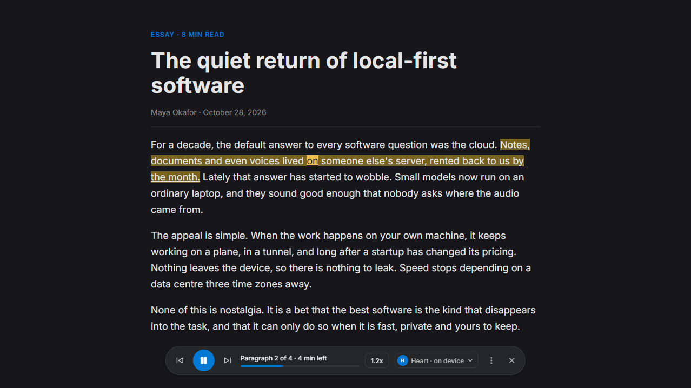
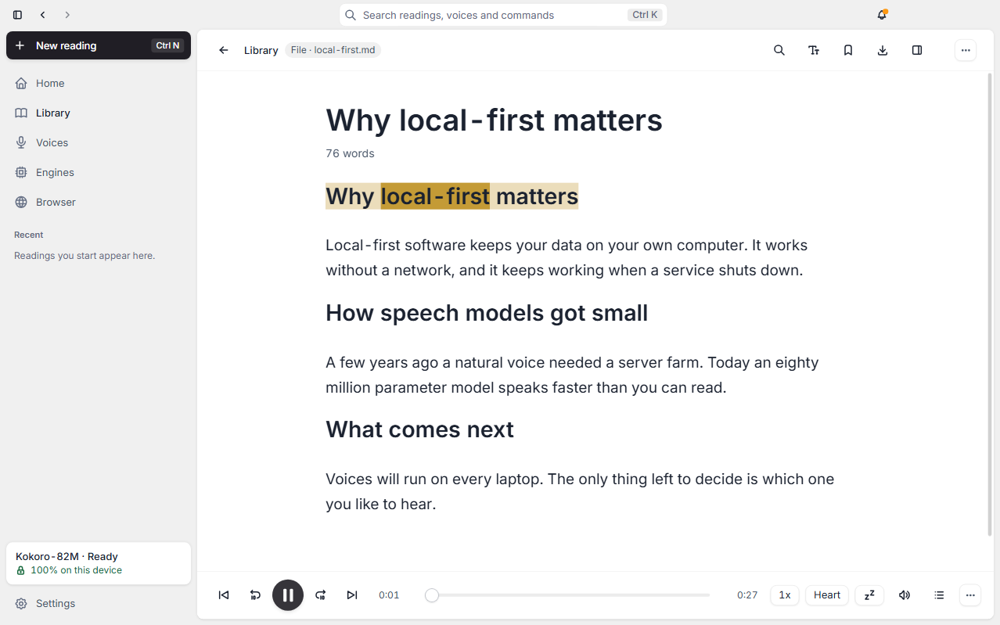
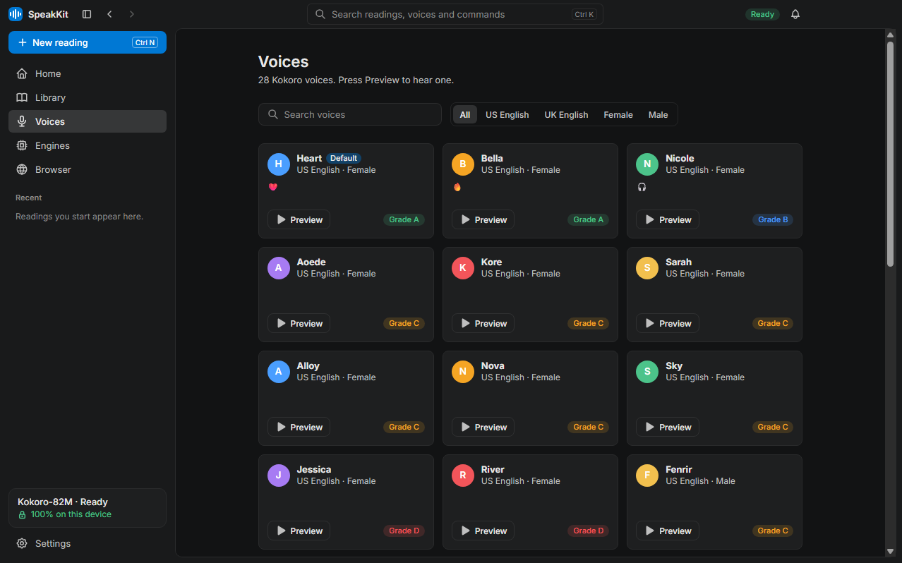
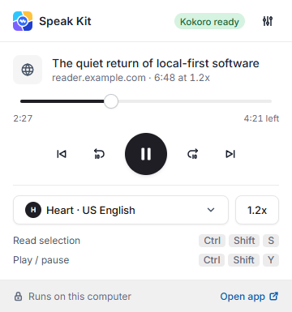
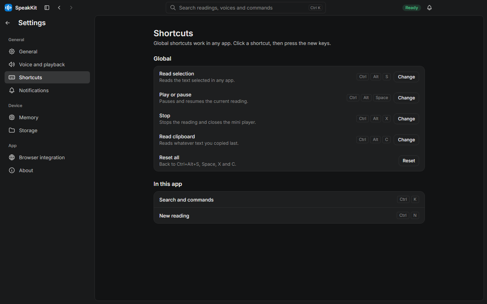

<p align="center">
  
</p>

<h1 align="center">Speak Kit</h1>

<p align="center">A private, local text-to-speech reader for Chrome and Windows.</p>

<p align="center">
  <a href="https://github.com/NourEldinShobier/speak-kit/actions/workflows/ci.yml"></a>
  <a href="LICENSE"></a>
</p>

A private text-to-speech reader. Select text in Chrome, press a key, and a natural voice reads it aloud while the sentence and word being spoken are highlighted. The voice model runs on your computer: no account, no cloud, nothing uploaded.

- **Chrome extension** (Manifest V3): reads selections and whole pages, floating player, reader view, side panel queue.
- **Desktop app** (Electron, Windows): runs the local voice server, lives in the tray, adds global shortcuts, a mini player, a library for files (PDF, EPUB, DOCX, Markdown, text) and MP3 or WAV export.
- **Voices**: 28 [Kokoro-82M](https://huggingface.co/hexgrad/Kokoro-82M) voices out of the box, and optional [Chatterbox](https://github.com/resemble-ai/chatterbox) voice cloning on machines with a GPU.

<p align="center">
  
</p>

| | |
|---|---|
|  |  |
| Reader with word highlighting (desktop app) | 28 voices, each with a preview |
|  |  |
| Extension popup | Global shortcuts you can change |

## Install

### Windows

Download from the [latest release](https://github.com/NourEldinShobier/speak-kit/releases/latest):

| File | What it is |
|---|---|
| `Speak-Kit-Setup-<version>.exe` | Installer. Start menu entry, optional start at sign-in, updates through GitHub Releases. |
| `Speak-Kit-<version>-portable.exe` | Runs from any folder, does not update itself. |
| `speakkit-extension-<version>.zip` | The extension, for Chrome, Edge or Brave. |

The builds are not code-signed, so Windows SmartScreen shows "unknown publisher" the first time. Choose **More info**, then **Run anyway**.

Start Speak Kit. The first run downloads the Kokoro model (about 180 MB) and walks through the setup.

### macOS

There is no macOS build yet; the app is built and tested on Windows only. The extension and the local server (`code/packages/server`) run on any system with Node 24. When macOS builds are published they will be unsigned: open the `.dmg`, drag the app to Applications, then right-click it, choose **Open** and confirm once (or run `xattr -dr com.apple.quarantine "/Applications/Speak Kit.app"`).

### Uninstalling

Everything Speak Kit stores is in one data folder: `%APPDATA%\@speakkit\desktop` on Windows, `~/Library/Application Support/@speakkit/desktop` on macOS, `~/.config/@speakkit/desktop` on Linux.

- **Windows:** uninstalling from Settings > Apps (or the Start menu entry) removes the downloaded voice models and engines (`models`, `engines`, exports and OCR language data). Installing a new version over the old one keeps them. Your library, cloned voices, settings and pairing token stay; delete the data folder to remove them too.
- **macOS:** the app has no uninstaller. Before you drag Speak Kit to the Trash, open Settings > Storage > Delete downloaded models and engines. Otherwise delete `~/Library/Application Support/@speakkit/desktop/models` and `.../engines` yourself.
- The same button exists on Windows and frees the space without uninstalling.

### The Chrome extension

- **Chrome Web Store**: not listed yet. This section will link it once it is.
- **Load unpacked** (works now): unzip `speakkit-extension-<version>.zip`, open `chrome://extensions`, turn on **Developer mode**, choose **Load unpacked** and pick the unzipped folder. The desktop app can do this for you: **Browser**, **Install from this app**.

Then pair the extension with the app: copy the token in the app (Browser) and paste it in the extension under Options, General, Pairing token.

## Keyboard shortcuts

Global, work in any app while the desktop app runs (change them in Settings, Shortcuts):

| Keys | Action |
|---|---|
| Ctrl+Alt+S | Read the selected text |
| Ctrl+Alt+Space | Play or pause |
| Ctrl+Alt+X | Stop |

In the browser the extension suggests these (change them at `chrome://extensions/shortcuts`; on macOS the modifier is Command):

| Keys | Action |
|---|---|
| Ctrl+Shift+S | Read the selection or the page |
| Ctrl+Shift+Y | Play or pause |
| Ctrl+Shift+X | Stop |

In the app: Ctrl+K opens search and commands, Ctrl+N starts a new reading.

## How it works

```
Chrome extension --\                          /-- Kokoro (child process, unloads when idle)
(page, popup,       \   HTTP + bearer token  /
 side panel)         >---------------------> Local server
Desktop app         /    127.0.0.1 only      \
(tray, shortcuts,  /                           \-- Chatterbox (optional Python sidecar)
 library, export) -/
                      <-- audio streamed sentence by sentence
```

The desktop app starts a server on `127.0.0.1`. The extension and the app send it text; it streams audio back one sentence at a time, so playback starts quickly and the page can highlight the sentence being spoken. The engine loads the model when needed and unloads it after a period of silence to free memory. Details: [`docs/architecture.md`](docs/architecture.md).

## Privacy

- Text is synthesized on your computer. The server listens on `127.0.0.1` only, needs a bearer token, and rejects requests from web pages.
- The extension talks only to that local server. It asks for `storage`, `contextMenus`, `offscreen`, `sidePanel`, `activeTab` and `scripting`, plus access to `127.0.0.1` and `localhost`.
- The only network traffic is the one-time model download and the update check against GitHub Releases, which you can turn off in Settings, About.
- No analytics, no accounts. To report a vulnerability see [SECURITY.md](SECURITY.md).

## Build from source

Needs Node 24 (24.11 or newer) and pnpm 12. Everything is in [`code/`](code); the toolchain is Vite+ (`vp`) and the type-checker is tsrs.

```
git clone https://github.com/NourEldinShobier/speak-kit.git
cd speak-kit/code
pnpm install --frozen-lockfile
pnpm typecheck                                   # tsrs on every project
pnpm --filter @speakkit/desktop exec vp build    # build the desktop app
pnpm --filter @speakkit/desktop start            # run it
pnpm --filter @speakkit/extension exec vp build  # extension in apps/extension/dist
```

Build the Windows installer with `pnpm --filter @speakkit/desktop exec node scripts/package.mjs` (output in `code/apps/desktop/release`). Test commands per area are in [CONTRIBUTING.md](CONTRIBUTING.md).

## Project layout

| Path | What |
|---|---|
| `code/apps/extension` | Chrome extension |
| `code/apps/desktop` | Electron app |
| `code/packages/server` | Loopback HTTP server and CLI |
| `code/packages/engine` | Engine interface, Kokoro in a child process, Chatterbox sidecar |
| `code/packages/player` | Shared gapless playback |
| `code/packages/protocol` | API types, audio frame codec, extension messages |
| `code/packages/ui` | The Lockix-styled (Lumen) component kit shared by the extension and the app |
| `code/e2e` | Playwright suites |
| `designs/` | Design source, generator and built screens |
| `docs/` | [Documentation index](docs/index.md) |

## Contributing

Issues and pull requests are welcome. Read [CONTRIBUTING.md](CONTRIBUTING.md) and the [Code of Conduct](CODE_OF_CONDUCT.md) first.

## License

[Apache License 2.0](LICENSE), Copyright 2026 Nour Eldin Shobier. Third-party software, models, fonts and icons are listed in [THIRD_PARTY_NOTICES.md](THIRD_PARTY_NOTICES.md). Kokoro-82M is Apache-2.0 and Chatterbox is MIT; their weights are downloaded, not bundled.
